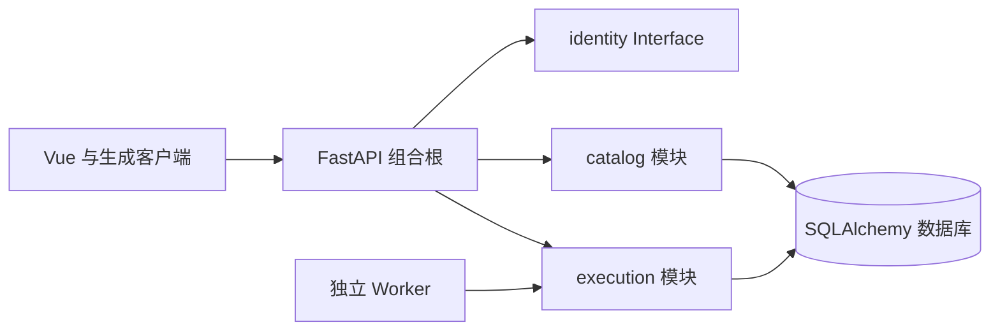

# 架构

## 当前结构

一个仓库、前后端分目录；后台为模块化单体，两种进程入口复用同一包。

core 只含基础设施，不依赖 modules。业务模块的 router 可引用 identity 的 actor Interface，其余跨模块运行时依赖需要明确装配。已有 AST 守卫检查这条规则，不能为了绕过失败改成动态 import。

## 已实现的纵向样板

- catalog：Pydantic 契约→router→service→SQLAlchemy，创建和列表/详情按 actor.user_id 限定；无权 ID 与不存在 ID 都返回 404。
- identity：只有不可伪造的接入位置，目前始终返回 AUTH_NOT_CONFIGURED。测试通过依赖注入切换 actor；没有测试登录 HTTP 接口。
- execution：job 持久化、用户范围查询、唯一幂等键、条件更新领取、60 秒租约、最多三次尝试、旧 token 不能提交终态。仅实现短诊断任务。
- health：liveness 不依赖数据库；readiness 实际检查迁移后的任务表可读。

这些不是完整模式目录、多用户身份、研究队列或权限系统。owner 为新工程示例字段；接入旧用户体系时保留其业务 ID。

## 数据与作业语义

开发使用独立 SQLite；目标为 MySQL 兼容数据库。Alembic 初始迁移创建两张新表，服务启动不执行 DDL。测试实际执行初始迁移两次，验证迁移版本记账而非重复创建。

job 是基础设施工作项，不是研究 Run。当前诊断通过不代表策略有效或回测成功。长研究任务尚缺续租心跳、合作取消、用户配额、Run/attempt 映射与 ArtifactStorage 发布，这些实现前不能注册真实计算。

首次接入真实研究时，显式适配旧工程的 DatasetVersion、StrategyVersion、Strategy Core、Backtest Core、canonicalMetrics 和产物访问。Python 迁移需要固定样本与逐笔/权益对拍，不从原型常量生成真实结果。

## 后续模块按功能落地

| 模块 | 职责 | 当前状态 |
|---|---|---|
| identity | 会话、用户、权限 | Interface 已留，认证待接入 |
| catalog | 模式目录、定义与证据、关注 | 私人目录样板 |
| execution | 作业调度与 Worker | 有界诊断样板 |
| market / datasets | 行情与冻结数据集 | 待实现 |
| research / discovery | 实验运行与人工评审 | 待实现 |
| strategies / backtests | 版本化策略、撮合与规范指标 | 待适配，对拍后迁移 |
| journal | 私人决策、偏差与笔记 | 待实现 |

## 前端

Vue Router 管页面，Pinia 仅存界面偏好，服务端数据经 openapi-fetch。界面明确区分无数据、未接入认证和连接失败，不能用示例数据覆盖失败。

Element Plus 管基础组件，样式 token 管全局主题；ECharts 在真实图表页面接入时再安装，不预装所有未来插件。私人数据不放入跨用户共享缓存。

## 能力边界

框架本地验证以 SQLite、Node/Python 和 HTTP 冒烟为准。Docker/MySQL、真实认证、远程 CI、正式部署及旧研究迁移分别验收。生产模式有明确启动阻断，不能只将它删掉就当作通过验收。
