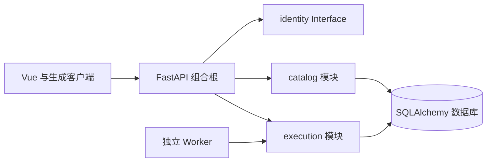

# 架构

## 当前结构

一个仓库、前后端分目录；后台为模块化单体，两种进程入口复用同一包。

core 只含基础设施，不依赖 modules。业务模块的 router 可引用 identity 的 actor Interface，其余跨模块运行时依赖需要明确装配。已有 AST 守卫检查这条规则，不能为了绕过失败改成动态 import。

## 已实现的纵向样板

- catalog：Pydantic 契约→router→service→SQLAlchemy，创建和列表/详情按 actor.user_id 限定；无权 ID 与不存在 ID 都返回 404。
- identity：自建注册/登录。密码用标准库 scrypt 哈希；会话是不透明令牌，数据库只存令牌哈希，登出与改密立即撤销；连续失败按配置锁定。未配置 RP_AUTH__SECRET 时保持 AUTH_NOT_CONFIGURED，不假装已认证。
- execution：job 持久化、用户范围查询、唯一幂等键、条件更新领取、60 秒租约、最多三次尝试、旧 token 不能提交终态。仅实现短诊断任务。
- health：liveness 不依赖数据库；readiness 实际检查迁移后的任务表可读。

这些不是完整模式目录、多用户身份、研究队列或权限系统。owner 为新工程示例字段；接入旧用户体系时保留其业务 ID。

## 数据与作业语义

开发使用独立 SQLite；目标为 MySQL 兼容数据库。Alembic 初始迁移创建两张新表，服务启动不执行 DDL。测试实际执行初始迁移两次，验证迁移版本记账而非重复创建。

应用库和外部研究源分别配置，连接工厂位于 core/database.py；迁移、API 与 Worker 只绑定应用库。源默认关闭，不自动继承旧凭据或参与应用 readiness。实际授权与接入验收见运维“数据库配置与数据源接入”和决策 D09。

job 是基础设施工作项，不是研究 Run。当前诊断通过不代表策略有效或回测成功。长研究任务尚缺续租心跳、合作取消、用户配额、Run/attempt 映射与 ArtifactStorage 发布，这些实现前不能注册真实计算。

首次接入真实研究时，显式适配旧工程的 DatasetVersion、StrategyVersion、Strategy Core、Backtest Core、canonicalMetrics 和产物访问。Python 迁移需要固定样本与逐笔/权益对拍，不从原型常量生成真实结果。

## 后续模块按功能落地

| 模块 | 职责 | 当前状态 |
|---|---|---|
| identity | 会话、用户、权限 | 自建注册/登录；密码重置、SSO 待实现 |
| catalog | 模式目录、定义与证据、关注 | 私人目录样板 |
| execution | 作业调度与 Worker | 有界诊断样板 |
| market / datasets | 行情、冻结数据集与市场状态描述 | market 行情读取与只读市场状态描述已实现；冻结数据集待实现 |
| research / discovery | 实验配置、运行溯源、结果与评审；知识笔记外置 | 待实现 |
| strategies / backtests | 版本化策略、撮合与规范指标 | 待适配，对拍后迁移 |
| journal | 私人决策、偏差与笔记 | 待实现 |

## 前端

Vue Router 管页面，Pinia 存会话与界面偏好，服务端数据经 openapi-fetch；界面区分无数据、未认证和连接失败，不用示例数据覆盖失败。

框架按原型（Open Design，见运维“前端原型”）落地：`styles/base.css` 承载设计 token（深色默认、浅色属性覆盖）；`navigation.ts` 是导航单一来源；`routes.ts` 可测，`router.ts` 负责会话守卫；`AppRail`/`AppTopbar` 组成壳层。`implemented: false` 的入口禁用并标“待开发”，路由指向统一的 `PlannedPage`，不伪造页面。壳层外只渲染登录页与公开的 `/about`：登录页用原型 `auth.html` 的左右分栏，但示例行情预览换成 `PlatformStatus`（只读 `/health/live`、`/api/v1/market/session`、`/api/v1/market/sources` 三个公开接口，失败即显示失败）；原型的演示账号、验证码、第三方登录与找回密码无后端能力，不实现。能力陈述集中在 `product.ts` 供两页共用，`/about` 路线图直接读 `navigation.ts`，两者不会各说一套。

Element Plus 管基础组件，样式 token 管全局主题。简单趋势、热力和 K 线优先使用与原型 tokens 一致的轻量 SVG，避免通用图表库默认样式破坏页面层级或造成不必要的包体；仅在缩放、复杂组合与大规模交互需要时按实际页面引入图表库。私人数据不放入跨用户共享缓存。

## 研究工作流与统一结果展示

本节是后续开发必读约定；研究执行与统一查看器尚未实现，本机 Obsidian 知识专区已配置，位置见运维“研究知识库”，取舍见决策 D06–D08。实施顺序：选一条高频研究链路 → 复用现有入口并验证缓存/对拍 → 接入统一查看器；知识工具独立使用，不作为研究开发前置项目。

### 知识与产物分开

- 工程规则留在现有六份正式文档；研究主题、笔记和结论使用现成知识工具；运行元信息及证据由研究系统保留。
- 研究前检索已有主题与失败实验；同主题更新主结论，实验保留独立记录和证据链接，不逐次复制背景或生成“最终版”文档。
- 结论区分待验证、已复核、已否定；AI 输出先作为草稿。关联数据版本、代码版本、实验参数、运行 ID、适用范围与局限。
- Markdown/HTML 是按需导出格式，不是每次运行的默认交付。原始明细、图表、报告作为运行产物管理；长期证据存储须显式配置并备份，不把 .scratch 当长期存储。
- 旧研究资料先盘点、归档，再整理有效主题；保留来源，不直接删除或因标题相似合并不同实验。自动清理不得触及证据。

### 配置式研究与数据复用

1. 先定位已有正式入口、配置、冻结快照和缓存；旧 scripts/factor_lab 仅是待验证的复用候选，不代表已迁入本工程。
2. 因子、分档、时间或样本条件变化优先新增配置；新算法扩展正式模块并补测试，通用命令纳入唯一任务入口。一次性探针放 .scratch，不成为正式研究执行链。
3. 原始数据按明确版本冻结；清洗/特征按依赖版本复用；统计结果按真实输入、规范化参数、算法/代码版本、随机种子及统计口径识别。缓存命名还须明确权限作用域，私有结果不能因相同哈希而跨用户共享。
4. 依赖变化使对应缓存失效；缓存命中仍校验身份、完整性及覆盖范围。不得以缺失填零、关闭校验或偷换样本换取速度。快照冻结后复用清单，避免每次无差别扫描所有源分片。
5. 同次批量研究按需加载列并共享已加载数据；跨进程复用磁盘缓存，不承诺零磁盘读取。区分数据库查询、磁盘读取和重复计算，分别记录耗时与命中情况。
6. 运行记录保留输入、配置、版本与结果位置；报告和图表读取已有统计，默认不导出全量逐笔或全池日线。改变展示不触发数据查询或研究重算；请求未计算结果时明确显示缺项。

首条链路验收：相同配置再次运行命中结果缓存；只改分档复用源数据与适用的特征；只改展示不触发计算；数据/算法变化正确失效；固定样本的新旧指标、样本账及适用的交易/权益摘要一致。测试报告实际读取量、命中与耗时，不把缓存存在视作性能达标。

### 统一结果契约

版本化契约至少包含：

| 内容 | 必需信息 |
|---|---|
| 元信息 | 契约版本、实验/运行 ID、数据/代码/算法版本、参数、随机种子（适用时）、状态、样本口径、因子最早可知时间与前视标记 |
| 维度 | 因子 ID、公式版本、单位、分档边界与开闭规则、显示顺序、缺失/未知类别 |
| 分组 | 各维度档位、样本总数、各指标可评估分母、缺失/排除数、指标值、可用区间及估计方法 |
| 证据 | 参考组、已有年度统计与汇总、明细索引和受控产物引用 |

私人结果与下钻明细沿用服务端用户范围检查；前端只拿授权后的资源标识，不暴露磁盘路径或通过隐藏按钮代替鉴权。失败、未完成、空样本、缺失值与数值零分别表达。

### 一个查看器覆盖不同维度

固定布局：运行/版本/口径信息 → 指标、参考组与最低样本数控件 → 样本摘要 → 主图 → 共用分组明细 → 选中组的定义、已有年度统计及授权样本下钻。

| 维度 | 默认视图 | 交互 |
|---|---|---|
| 一维 | 分组柱状图与表格 | 指标切换；已有区间可展示，样本量同时可见 |
| 二维 | 热力图与表格 | X/Y 为分档；颜色为选定指标；单元格/提示含指标及对应样本分母；点击下钻 |
| 三维 | 第三因子分面下的二维热力图 | 档位少用小多图，档位多切换；各面相同坐标顺序和颜色范围，不默认使用立体图 |
| 四维以上 | 任意两维为轴，其余维度切片 | 固定其他档位，或选择研究端提供的合法汇总；组合明细可筛选排序，不默认展开所有组合 |

低样本组明确淡化/标记，不因最低样本数控件而悄悄改变原样本账；缺失/未知、无样本与零值不共用一种色义。颜色标尺、单位、参考组及分母明确，分面指标可直接比较。

比例仅可用正确分子/分母合并，均值需相应有效样本权重；中位数、统计区间与非可加指标不能直接平均分组值。汇总由研究端提供，或通过契约明确允许的可合并统计量完成；年度切换与切片若无预计算结果则显示不可用，不暗中重跑。排序不等于推荐策略，展示稀疏性及适用的多重比较/样本内风险。

查看器验收包含分档端点、缺失与空组、指标分母、参考组、三维共用色阶、多维切片/汇总、越权下钻和失败状态；图表与同一结果明细一致。首版不包含自由拖拽 BI、在线重算、知识库编辑器或每实验独立 HTML 页面。

## 公共开发底座

本节定义错误/日志、前端请求和基础数据契约，依据为决策 D10–D12。错误、关联日志与前后端超时/重试策略已按样板实现；前端请求层的会话失效装配、基础数据类型尚未实现，已在对应小节标出。运行参数与停止顺序见运维“进程生命周期”。

### 统一错误与日志

- 保留成功响应的资源/列表结构，不增加通用 success/data 包装。失败统一为 `detail: {code, message, request_id, fields?}`；fields 仅含字段路径与稳定错误码，不含原始输入值。401/403/404/409/422/429/500/503 维持真实 HTTP 语义，不把错误变成 HTTP 200。
- 业务码的 HTTP 状态、类别与安全文案由 `core/errors.py` 的 `ERROR_SPECS` 显式映射决定，不再按字符串后缀推断；未登记的码落到兜底规格（400），视为评审缺口。参数校验、HTTP 异常与未处理异常都在组合根归一化。
- 未处理异常返回固定安全文案 `INTERNAL_ERROR`，内部诊断写经脱敏日志，不回传 SQL、地址、路径、堆栈或凭据。未知路由 404、方法不允许 405、校验 422、非 JSON 响应都有安全退路；已发出响应头后不得再改写响应体。
- 服务端为每个请求生成 request_id，响应头 `X-Request-ID` 与错误体同值。`core/logging.py` 用 ContextVar 维护请求/任务上下文，在 finally 中重置，并发请求不串号；外部传入标识不作为可信日志字段。Worker 以 `job_scope(job_id, job_type, attempt)` 关联，记录受控错误码，永不记录租约 token。
- 使用 Python 标准 logging 和单一 JSON 输出配置（`configure_logging(role, level)`），不引入 ELK/分布式追踪平台。每条事件含 UTC 时间、级别、进程角色、事件名与 request_id/job_id（适用时）；`request.completed` 另含路由模板、方法、状态、`duration_ms` 与 `error_code`。路由以模板记录（如 `/api/v1/catalog/{entry_id}`），未匹配固定为 `unmatched`，避免把路径中的 ID 写进日志。
- API/Worker 共用 `sanitize`：按字段名子串脱敏 password/token/authorization/cookie/secret/连接串等，自由文本再按「含凭据 URL」「`key=value` 赋值」「Bearer/Basic」三类模式替换为 `[redacted]`/`[redacted-url]`；未知对象只渲染类名，请求头走白名单。异常只记录 `error_type`（类名），禁止 `str(exception)` 与堆栈；请求体、完整查询串、Cookie、Authorization 默认不记录。生产只写 stdout/stderr，轮转交由运行环境负责。

验收集中覆盖业务/校验/内部异常、错误体与响应头关联、并发上下文隔离、耗时字段、路由模板化与日志无敏感输入。结构化日志是排错依据，不等同于完整安全审计记录。

### 超时与重试

策略形状统一（超时、最多重试次数、退避、可重试状态），执行按访问类型分开。规则集中在 `core/policies.py`，前端在 `frontend/src/api/policies.ts` 有与之对应的同值表；调用点不得自行写死超时秒数与重试次数。新增访问类型时两侧同步登记，避免前后端对同一请求给出不同的等待语义。

| 访问类型 | 适用 | 超时 | 自动重试 |
|---|---|---|---|
| read | GET/HEAD 查询 | 15 秒 | 最多 1 次，退避 300 毫秒；仅网络故障与 502/503/504 |
| write | POST/PUT/PATCH/DELETE、提交后台作业 | 30 秒 | 从不；重复保护由幂等键与唯一约束承担 |
| diagnostic | liveness/readiness 探活 | 5 秒 | 从不，快速失败 |
| worker-connect | Worker 进程连库 | 10 秒 | 最多 3 次，退避 1/2/4 秒，可被停止信号唤醒 |
| database-read | 应用库读取 | 60 秒（连接参数 read_timeout） | 由调用方决定，不在驱动层重试 |

提交后台作业归入 write：接口只写一行作业并立即返回 202，长任务在作业内继续，不靠延长 HTTP 超时等待结果。

- 超时由真正持有 I/O 的边界执行：HTTP 在浏览器请求层，MySQL 在连接参数（connect_timeout/read_timeout），作业在 `lease_until`。不在外层用定时器包住阻塞数据库调用——放弃等待后连接仍存活，会造成资源泄漏与假超时。
- 不重试的情形：主动取消、超时本身、4xx 校验与权限错误、429（不忙等重发，展示限制并按服务端提示处理）、任何写请求。可重试状态由策略表声明，不在调用点判断。
- Worker 进程级连库重试与任务 attempts/租约重试分别计数：进程重启不是一次新研究，耗尽退避后非零退出，交由运行环境按有界策略重启。
- 数据库死锁等重试只针对明确可重放、无外部副作用的完整短事务；不盲目重放任意 POST/外部调用。
- 耗时计算提交为后台任务，不通过无限延长 HTTP 超时解决；网关/反向代理超时按用途单独协调。

### 前端公共请求层

- 在现有 openapi-fetch 上封装公共行为，继续由 OpenAPI 生成类型，不换一套 HTTP 库。结果至少能区分业务错误、HTTP 错误、网络不可达、超时、主动取消与非预期响应，保留安全 message/code/request_id。
- 超时与重试按上节访问类型执行；页面显式声明 read/write/diagnostic，不再逐个设置毫秒数。通用请求默认 15 秒。
- 页面离开、组件卸载或同查询被替代时支持取消。用户主动取消不弹错误提示；取消请求并不回滚后端写操作或取消后台作业。同一查询采用最后一次有效响应更新界面，旧响应不得覆盖新筛选。
- 写请求防重复点击；需要幂等的提交沿用原幂等键，不以禁用按钮替代服务端约束。加载/空态/失败态有共用表达，不必现在建设通用服务端缓存层。
- 失败提示显示服务端 `request_id`，便于按日志定位；不显示堆栈或原始对象。401 进入统一会话失效处理（真实身份接入后装配），403 不反复跳登录；当前 AUTH_NOT_CONFIGURED 保持未接入语义。错误显示由调用页面或全局兜底选一处负责，避免重复弹窗。私人数据不进入持久化浏览器缓存或跨用户共享状态。

验收使用受控响应覆盖超时、主动取消、过期响应、重复提交与非 JSON 错误；契约变化同步生成类型。

### 基础数据与接口约定

| 类型 | 新公开接口约定 |
|---|---|
| 资源 ID | 不透明字符串；旧源 bigint 在适配层无损转字符串，浏览器不经 Number 转换；服务端内部 actor ID 可保留原类型 |
| 股票标识 | 代码为字符串保留前导零，并关联交易所/市场；展示名称不能作为唯一标识 |
| 交易日期 | YYYY-MM-DD，不带时间、不做 UTC 日期平移；交易日历与市场时区显式区分 |
| 时间戳 | 对外 ISO 8601 UTC，含 Z 或 +00:00；拒绝无时区的新接口输入。旧库 naive UTC 只在适配层按已证明的语义转换，不静默重写已有租约和历史数据 |
| 金额与价格 | 权威计算使用 Decimal/数据库 DECIMAL，接口为十进制字符串；币种、精度和舍入策略在字段/算法契约声明，不统一武断截为两位；前端转换只用于展示 |
| 收益与概率 | 新字段用明确命名/单位：x_pct 的 1 表示 1%，x_ratio 的 0.01 表示 1%；概率用 0–1。研究分档元数据保留单位，旧结果在适配层明确转换，不能改动原计算语义 |
| 研究统计值 | 有限 JSON number；空值为 null，未知/缺失/不可评估原因另有字段；NaN/Infinity 禁止输出，缺失不填 0；质量标记与每指标分母保留 |
| 列表 | 延续 items/total/offset/limit，limit 由服务端限定；排序稳定、客户端输入白名单化；不强行引入游标或 count 缓存 |

请求拒绝额外字段；写请求的“省略”与显式 null 按字段定义，不在通用客户端擅自转换。错误码、枚举、默认值和字段单位以 schema 为准，协议变更同步 OpenAPI/测试并说明兼容影响；不为字段类型提前创建通用 DSL 或大量基类。

### 事务与并发：只保留必要保护

- 数据库本地事务保留，但暂不引入 Unit of Work 框架、分布式事务、消息总线、分布式锁或全局 SERIALIZABLE。一次写操作也有提交/回滚语义，用户少不是取消原子性的理由。
- 顶层业务入口负责一个短事务的提交与失败回滚；同一业务操作需要多表写入时同一事务完成，内部 helper 不自行 commit。简单单表写保持简单；读操作不额外包全局锁。认证查询若共用 session，应明确已有事务状态，不能机械嵌套 begin。
- 耗时计算、源库读取及文件/网络 I/O 不放在应用写事务中；结果先可靠写入，再在短事务中发布引用，失败显式保留待处理/失败状态。不把数据库与文件视为天然原子操作。
- 现在沿用任务唯一幂等键、条件领取和租约 token 校验；普通查询不加锁。可编辑资源真正出现多人覆盖场景时再启用带版本条件的更新与 409 冲突；已有 row_version 字段不代表乐观锁已实现。
- 数据库死锁等重试仅针对明确可重放、无外部副作用的完整短事务；不盲目重放任意 POST/外部调用。源库只读仍由数据库授权保证，不用事务 READ ONLY 标记冒充安全隔离。

当前只确立约定并保留已有任务保护；无需为未来可能的事务创建新框架。实现某项并发行为时，才针对其回滚、冲突或重复领取增加验证。

## 外部数据服务与公共访问

外部行情只读、无写入、无私有凭据，因此与“研究源数据库”分开：源库走 `core/database.py` 的 SQL 连接（决策 D09），公共行情走 `core/upstream.py` 的 HTTP 访问。两者都不允许把供应商原始报文当作内部契约。

### 已实现的取数能力

| 能力 | 来源 | 接口 | 语义与限制 |
|---|---|---|---|
| 实时快照 | 腾讯 | `/api/v1/market/quote` | 最新价、昨收、涨跌停、行情时间；覆盖沪深北与指数 |
| 全球市场概览 | 新浪报价 + 多源日线 + 应用库快照 | `/api/v1/market/global/overview` | 登录后读取纳指、道指、KOSPI、日经、半导体、创业板、科创50、黄金与原油；报价先取新浪批量快照，失败时回退东方财富、最后雅虎；日线按标的采用新浪、腾讯、Naver 或 Yahoo Japan，并并发刷新、受总预算约束；应用库优先，外网失败回退最近快照并标记 `stale`，单标的旧快照单独标记 |
| 日内K线 | 腾讯 | `/api/v1/market/intraday` | m1/m5/m15/m30/m60，单次最多约 800 根；无北交所覆盖；09:30 分钟线只含开盘集合竞价 |
| 竞价 | 新浪撮合 + 东方财富曲线 + 腾讯分笔兜底 | `/api/v1/market/auction` | 09:15–09:25 虚拟撮合曲线（东财）+ 09:25 实际成交（新浪，股数精确，覆盖沪深北/科创/ETF/指数）；东财被反爬拒绝时降级为仅成交并标记 `degraded` |
| 日线 | Tushare | `/api/v1/market/daily` | 需 token；用于对账与历史，不作为日内来源 |
| 历史复盘 | 旧研究源（只读）+ 冻结市场状态 | `/api/v1/market/review/context`、`dates`、`overview`、`indices`、`limit-up`、`stock-series` | 登录后读取共享历史；默认日/前后交易日、涨停梯队、当日明细、个股日 K/MA、统计序列与四指数；涨跌停日历家数取同日冻结市场状态，缺失保持 null；覆盖仅为行存在性 |
| 源状态 | 本服务 | `/api/v1/market/sources` | 各源是否配置及支持能力 |

模块 `modules/market/` 内 `symbols`（A 股标识归一）、`global_types`（跨市场标的与口径）、`global_source`（多源回退）、各 provider、`service`（选源与缓存）、`review`（历史口径与纯计算）、`legacy_review_source`（旧表只读适配）、`router`（HTTP）分层；provider 只依赖 `core`。北交所、涨跌停、停牌或“今日无成交”必须是显式错误码或 null，不得返回空数组冒充成功。

### 标识、单位与时间

- 标的规范形态为后缀式 `600519.SH`/`000001.SZ`/`920982.BJ`（与 Tushare `ts_code` 一致），响应中的 `symbol` 一律用该形态；入参接受 `600519`、`sh600519`、`sh.600519`、`600519.sh` 等变体并统一折叠，各 provider 再各自转换为 `sh600519`、`1.600519`。上证指数号段（`000001`/`000010`/`000016`/`000300`/`000688`/`000852`/`000905`）与深市股票共用 `000xxx`、深市指数 `399001`/`399106` 亦需区分，这些裸代码必须带交易所，不做猜测（此前只有 `000001` 被拦住，`000300` 会被静默归到深市并返回空数据）。
- 成交量在边界换算为**股**并以下标 `volume_shares` 暴露：腾讯分钟线除科创板(688/689)按股外均为手；东方财富竞价按手（含科创板）；腾讯分笔与 Tushare 日线按手；Tushare 日线 `amount` 为千元，换算为元。腾讯快照的成交量在股票/ETF/指数间口径不一致，因此命名为 `volume_lots` 且不宣称是股数，股数以日内K线为准。
- 降级时科创板竞价股数取自 09:30 分钟线（只含集合竞价），避免整手换算误差；金额以供应商原始值为准。时间固定 `+08:00`（1991 年后无夏令时，Windows Python 常无 IANA 库），对外为 UTC ISO 8601，另设 `trading_day`，不做跨日平移。

### 公共访问规则

- 单一 `UpstreamClient` 统一持有超时、按 provider 的最小间隔、响应上限与解码；只重试幂等 GET，最多一次，仅限连接失败与 502/503/504；4xx、429 与 POST 不重试。重定向不跟随（`follow_redirects=False`）：端点迁移是需要人工确认的源故障，不能静默跳到未评审的主机，也不能拖到“报文不是 JSON”才暴露。
- 日志只记录 provider、路径、错误类型与状态，不记录查询串、请求体或 token；供应商错误信息不进入响应体。失败映射为显式错误码（`MARKET_SOURCE_*`），空响应、不可解析报文、权限不足与限流分别表达，不能折叠成“无数据”。
- 竞价分层取数：09:15–09:25 虚拟撮合曲线只有东财提供；09:25 实际成交优先东财，降级时用新浪（`CN_MinlineService` 首行，成交量在沪深北/科创/ETF/指数均为精确股数，已用 `成交额 = 价 × 股数` 对账），最后兜底腾讯分笔。降级必须显式：`provider` 指明实际来源、`degraded=true`、`snapshots=[]`，`limits` 写明原因；不允许返回空曲线却不标记。
- 多主机的同一 endpoint 按序轮换（竞价曲线 `push2` → `push2his`），单个主机不可达不得决定其他主机结论。东财在 fake-ip 代理下会被解析到 `198.18.0.0/15` 且 TLS 重协商被拒，此时可经 `RP_UPSTREAM__HOST_ADDRESSES` 固定已核实地址：逐请求改写连接地址、保留 `Host` 与 TLS SNI，证书照常校验按域名进行；**不修改全局 `socket.getaddrinfo`**（进程级补丁在并发下会互相覆盖并污染后续解析）。
- 行情数据短期缓存于 `core/cache.py`（TTL + 条数上限 + 同键单飞，避免击穿后触发上游限流）；缓存键不含凭据，失败不入缓存。

### 不做的部分

日内K线和竞价**暂不落库**（决策 D13）；历史复盘只读旧源、不迁移旧表（决策 D15）。缺失、真实零值和不可评估必须分开：无涨停行、前一日缺口、连板链触顶时板数和情绪分返回 null，覆盖 `available` 只表示源中有行。真实网络、MySQL/TiDB 表结构与数据完整性仍需接入后验收，本地 mock 通过不算。

## 能力边界

框架本地验证以 SQLite、Node/Python 和 HTTP 冒烟为准；Docker/MySQL、远程 CI、正式部署及旧研究迁移分别验收。生产模式按凭据阻断，不能只删掉检查就当作通过验收。错误与关联日志只在本机 API/Worker 验证过；告警、聚合、审计与跨服务追踪不在本阶段，真实数据库及网关/浏览器超时仍需分别对拍。
